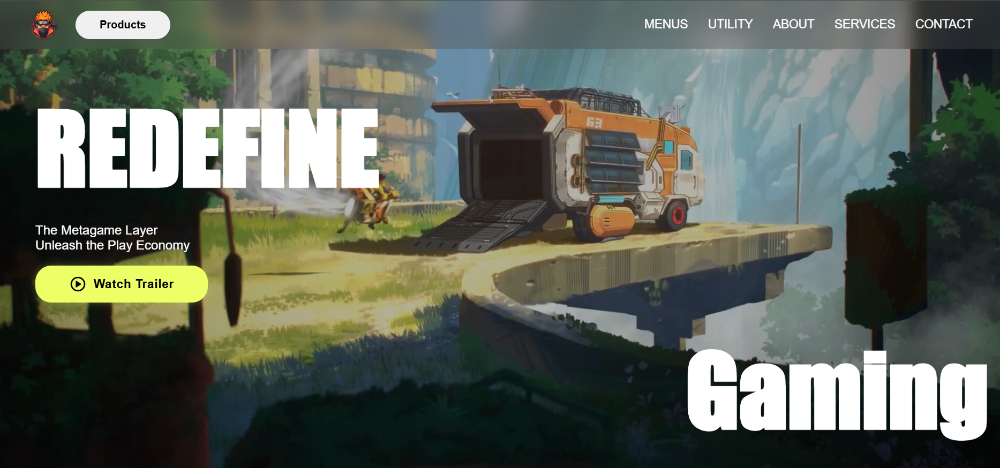
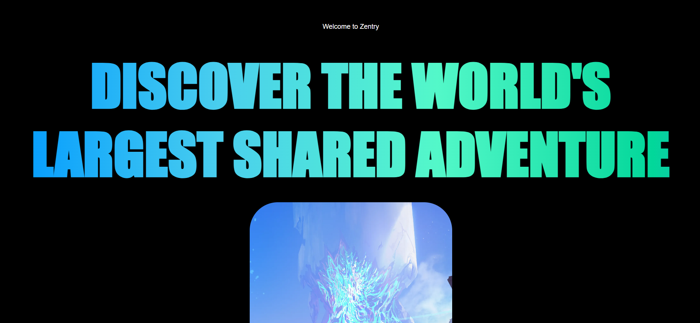
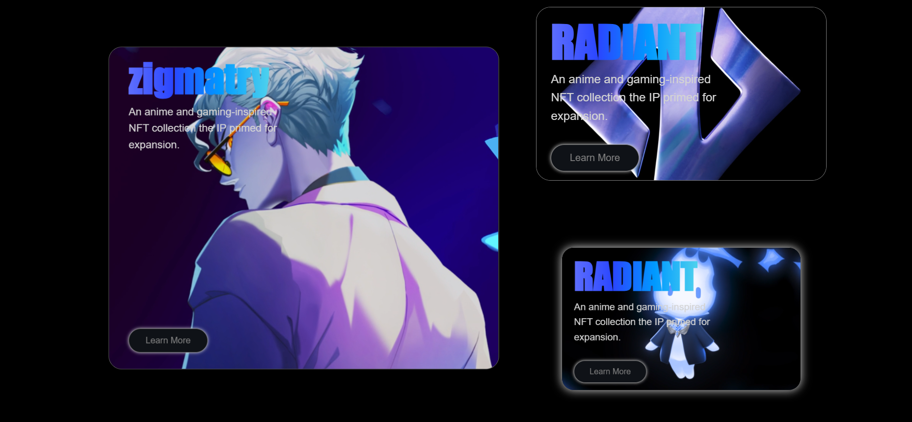
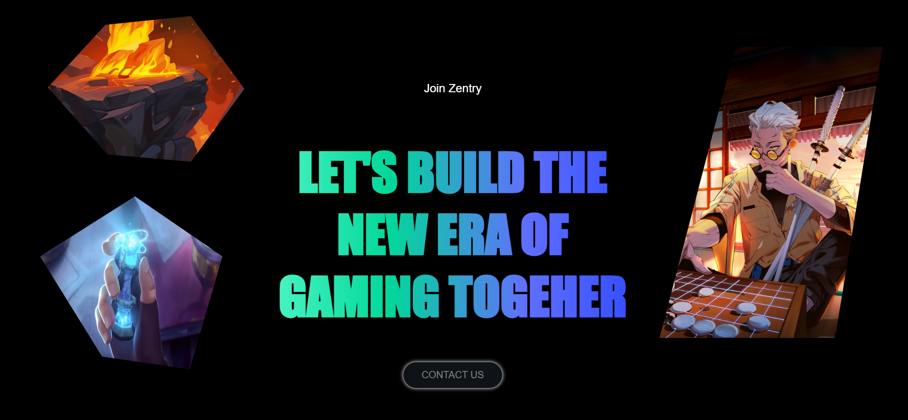

# 🎮 Zentry - Next-Gen Gaming Universe Website

An Awwwards-inspired, modern, and fully responsive gaming website built with **HTML5**, **CSS3**, and **JavaScript**. Featuring dynamic video backgrounds, cutting-edge scroll-driven animations, animated text gradients, neon dark aesthetics, and a seamless mobile experience.

---

## 🌟 Highlights & Features

- **🎮 Immersive Dark Aesthetic**: Sleek dark theme with neon cyan & lime glows, glassmorphism, and dynamic animated gradients.
- **🎬 Interactive Video Trailer Switcher**: Cycling hero video trailer system with smooth fade transitions.
- **⚡ Scroll-Driven Animations**:
  - `autoBlur`: Depth-of-field blur effect that resolves into crisp focus as elements scroll into view.
  - `autoTakeFull`: Dynamic full-screen expandable media showcase.
  - `autoDisplay`: Scale-and-translate entry animations on feature cards.
  - *Full Cross-Browser Support*: Native CSS scroll-timeline with an automated JavaScript `requestAnimationFrame` fallback for Safari, Firefox, and older browsers.
- **📱 100% Mobile & Touch Responsive**:
  - Custom mobile drawer navigation with animated hamburger toggle.
  - Fluid typography using CSS `clamp()` to eliminate horizontal overflow.
  - Touch-friendly action buttons and card grids.
- **🧱 Responsive CSS Grid & Flexbox**: Asymmetric desktop grid layout that cleanly stacks into single-column cards on mobile viewports.

---

## 📸 Screenshots

### Image 1


### Image 2


### Image 3


### Image 4


---

## 🛠️ Built With

- **HTML5**: Semantic structure, responsive meta viewport, video embedding.
- **Vanilla CSS3**:
  - Modern CSS Grid & Flexbox
  - CSS Scroll-Driven Animations (`animation-timeline: view()`)
  - Keyframe animations & linear gradients
  - Media queries (`1024px`, `768px`, `480px`, `360px`)
  - Glassmorphism (`backdrop-filter`)
- **Vanilla JavaScript (ES6+)**:
  - Mobile menu toggle & drawer controller
  - Interactive trailer cycling logic
  - Scroll-driven animation engine fallback
  - External link & CTA interaction handlers
- **Icons & Assets**: [Boxicons](https://boxicons.com/)

---

## 📂 Project Structure

```
gaming/
├── index.html          # Main HTML structure & semantic markup
├── style.css           # Global styles, animations & responsive media queries
├── app.js              # Interactive logic, trailer switcher & scroll engine
├── README.md           # Project documentation
├── demo/               # Website screenshots (image 1, 2, 3)
├── img/                # Graphic assets, backgrounds & decorations
│   ├── logo.png
│   ├── about.webp
│   ├── swordman.webp
│   ├── contact-1.webp
│   └── contact-2.webp
└── videos/             # Background hero videos & feature clips
    ├── hero-1.mp4 to hero-4.mp4
    └── feature-1.mp4 to feature-5.mp4
```

---

## 🚀 Getting Started

No build steps or complex dependencies required! Run directly in your browser.

### Option 1: Live Server (VS Code / Local Server)
1. Clone or download this repository:
   ```bash
   git clone https://github.com/your-username/gaming-website.git
   cd gaming-website
   ```
2. Open with VS Code and start **Live Server**, or run a local Python HTTP server:
   ```bash
   python -m http.server 5500
   ```
3. Open `http://localhost:5500` in your browser.

### Option 2: Direct Open
Simply double-click `index.html` to open it in any modern web browser.

---

## 📱 Responsive Breakpoints

| Device Category | Breakpoint Range | Key Adaptations |
| :--- | :--- | :--- |
| **Desktop / Wide** | `> 1024px` | Full asymmetric multi-column grid, hover trailer button |
| **Laptops / Tablets** | `769px - 1024px` | Scaled typography, adjusted floating decorative assets |
| **Mobile Landscape / Small Tablets** | `481px - 768px` | Single-column cards, mobile drawer menu, centered touch controls |
| **Mobile Phones** | `≤ 480px` | Compact headers, fluid clamp typography, full-width CTA buttons |

---

## 🤝 Author & Acknowledgments

- **Developed By**: Sagar
- **Design Inspiration**: Zentry & modern Awwwards gaming aesthetics

---

## 📄 License

This project is open source and available under the [MIT License](LICENSE).
